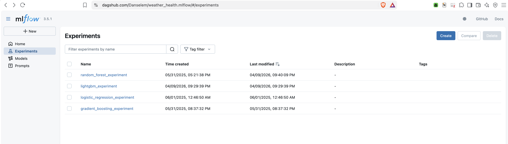
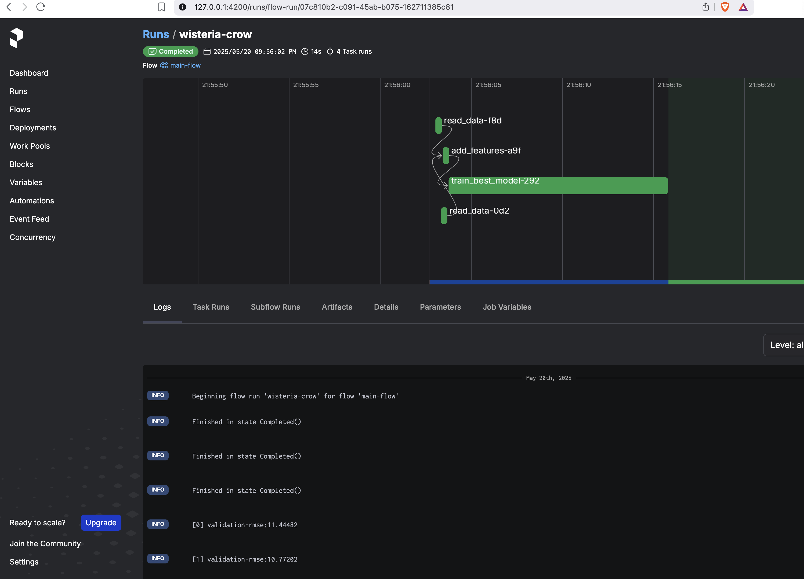
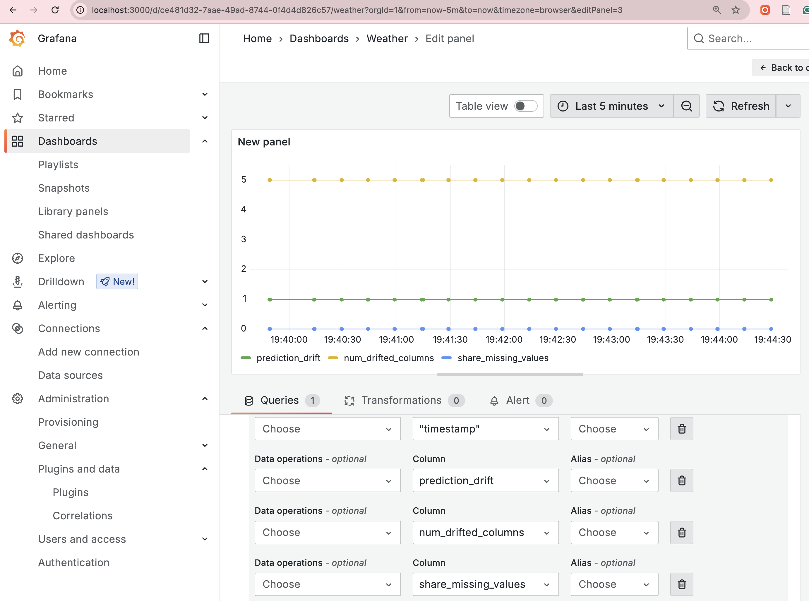
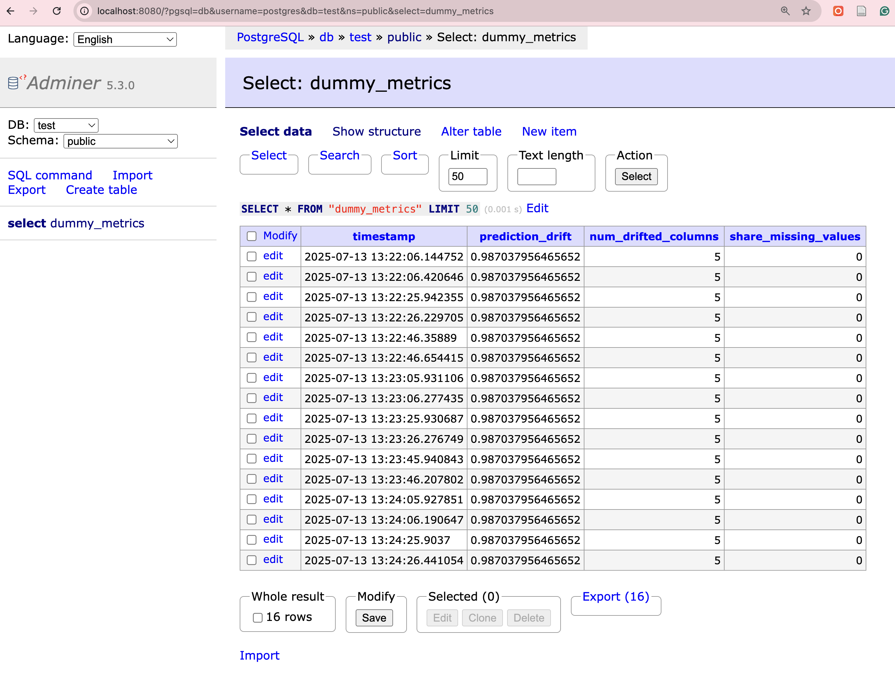

# Weather-Health MLOps

[](https://github.com/Danselem/weather_health/actions/workflows/ci.yml)
[](https://www.python.org/)
[](LICENSE)

An end-to-end MLOps system for 11-class weather/symptom disease prediction:
data versioning, reproducible training, champion promotion, containerized
serving, prediction logging, drift monitoring, and a guarded retrain loop.

**Author:** Daniel Egbo ([@Danselem](https://github.com/Danselem))

> **Scientific framing:** the dataset is synthetic and symptom-driven. The model
> is a pipeline demonstration, not a clinical tool. Weather-only features reach
> 37.6% accuracy; symptoms-only reach 98.7%. See [MODEL_CARD.md](MODEL_CARD.md)
> and [DATA_CARD.md](DATA_CARD.md).

---

## At a glance

| Area | Result |
|---|---|
| Held-out test accuracy | **0.9789** |
| Held-out test macro F1 | **0.9793** |
| 5-fold CV accuracy | **0.9794 ± 0.0035** (95% CI 0.9764–0.9825) |
| 5-fold CV macro F1 | **0.9790 ± 0.0041** (95% CI 0.9754–0.9826) |
| Calibration | Brier **0.0405**, ECE **0.0182** |
| Weather-only baseline | 0.3761 accuracy / 0.2294 macro F1 |
| Symptoms-only baseline | 0.9870 accuracy / 0.9880 macro F1 |
| Age accuracy gap | 0.0248 |
| Gender accuracy gap | 0.0019 |

---

## Architecture

```mermaid
flowchart LR
    Raw[Raw data] --> DVC[DVC remote]
    DVC --> Clean[Clean]
    Clean --> Validate[Data contract]
    Validate --> Transform[Split / encode]
    Transform --> Train[Train + Hyperopt]
    Train --> MLflow[(MLflow registry)]
    MLflow -->|@champion| Image[Docker image]
    Image --> API[FastAPI]
    API --> Store[(Prediction store)]
    Store --> Evidently[Evidently drift]
    Evidently --> Grafana[Grafana]
    Evidently -->|alert| Webhook[Slack / webhook]
    Evidently -->|repeated failure| Retrain[Guarded retrain]
    Retrain --> MLflow
```

See [docs/ARCHITECTURE.md](docs/ARCHITECTURE.md) for the detailed AWS topology,
data flow, and design decisions.

---

## Screenshots

| MLflow experiments | Prefect orchestration |
|---|---|
|  |  |

| Grafana monitoring | Adminer / prediction store |
|---|---|
|  |  |

---

## Quick start

```bash
git clone https://github.com/Danselem/weather_health.git
cd weather_health

uv sync --frozen
cp .env.example .env          # add DagsHub/DVC credentials if needed
dvc pull                      # data, model, and reference artifacts
```

Run the reproducible pipeline:

```bash
make dvc                      # clean → validate → transform → train → evaluate → ablation → analysis
make test                     # 35 tests, coverage gate in CI
make quality_checks           # ruff / black / mypy
```

Serve the model:

```bash
make serve_local              # http://localhost:8080
curl -X POST http://localhost:8080/predict \
  -H 'Content-Type: application/json' --data @sample_input.json
```

Start the monitoring demo:

```bash
make start-monitoring         # API :8000, Grafana :3000, Adminer :8081, Postgres :5432
make drift-demo               # generate drift + run the gate
make observe                  # compare logged predictions with the reference
```

---

## What is demonstrated

| Capability | Implementation |
|---|---|
| Configuration | Hydra env/model groups, flattened at runtime |
| Data versioning | DVC pipeline + DagsHub remote |
| Data quality | Schema/range/class/conflict checks |
| Experiment tracking | MLflow params, metrics, signatures, artifacts |
| Model registry | `@champion` alias, traceable run IDs |
| Reproducibility | Seeds, DVC lock, config, test isolation |
| Serving | FastAPI, Docker, `/health`, `/ready`, `/version`, `/predict` |
| Observability | Prediction logging, `/feedback`, `/stats`, confidence + top-k |
| Drift monitoring | Evidently tests against a pinned reference |
| Dashboards | Grafana drift + API/model performance panels |
| Alerting | Optional webhook; alert JSON fallback |
| Retraining | Prefect schedule + guarded GitHub retrain workflow |
| CI/CD | Lint, mypy, coverage, DVC repro, quality gate, Docker smoke, Checkov, Terraform validate |
| Infrastructure | AWS ECS Fargate, private subnets, Secrets Manager, remote state, budget |

---

## Project layout

```text
weather_health/
├── config/                  # Hydra base, env, model, cloud configs
├── data/                    # DVC-managed raw/interim/processed data
├── infra-aws/               # supported AWS stack + state bootstrap
├── infra-gcp/               # alternative Cloud Run reference stack
├── infra/                   # archived legacy MLflow stack
├── k8s/                     # local kind manifests
├── monitoring/              # compose stack, Grafana, runbook
├── reports/                 # DVC-managed metrics and plots
├── scripts/                 # rollback helper
├── service/                 # FastAPI app and serving Dockerfile
├── src/                     # pipeline, training, evaluation, monitoring
├── tests/                   # unit, artifact, API, and drift tests
├── dvc.yaml                 # reproducible pipeline stages
├── params.yaml              # DVC-facing paths and settings
├── prefect.yaml             # training + daily monitoring deployments
├── docs/                    # architecture, runbook, ADRs, archive
├── MODEL_CARD.md            # intended use, metrics, limitations
├── DATA_CARD.md             # dataset provenance and quality
├── CHANGELOG.md             # release history
└── Makefile                 # developer entry points (make help)
```

---

## Data and scientific findings

- 5,200 raw rows → 4,981 after duplicate removal; 45 features; 11 classes.
- Every cleaned feature combination maps to exactly one label. The dataset is
  deterministic by construction; headline metrics are not real clinical skill.
- Weather features carry little standalone signal. The model primarily learns
  symptom-to-disease patterns.
- Calibration is strong on the synthetic test set, but external/temporal
  validation is still missing.
- Slices and SHAP are descriptive, not a formal fairness certification.

Artifacts:

- `reports/evaluation_metrics.csv`
- `reports/ablation_metrics.csv`
- `reports/calibration_metrics.csv` + `reports/reliability_diagram.png`
- `reports/cv_metrics.csv`
- `reports/slice_metrics.csv`
- `reports/shap_summary.png` + `reports/shap_feature_importance.csv`

---

## CI/CD

`.github/workflows/ci.yml` runs on every push and pull request:

1. Ruff + mypy on core modules
2. `dvc pull` + pytest with coverage gate
3. `dvc repro` + data contract + model quality gate
4. Docker build + container `/ready` and `/predict` smoke test
5. Terraform format/validate + Checkov high-severity scan

`.github/workflows/deploy.yml` is manual and environment-gated:

- fetches `lightgbm_best_model@champion`
- builds and pushes an ECR image tagged with the model version
- registers a new ECS task definition and updates the service
- smoke-tests `/ready` and `/predict`

`.github/workflows/retrain.yml` runs on `repository_dispatch` or manually. It
trains, evaluates, runs the quality gate, and registers a new champion, but
never deploys automatically.

Rollback:

```bash
./scripts/rollback.sh <cluster> <service> <task-family> <revision>
```

---

## Documentation

- [Architecture](docs/ARCHITECTURE.md)
- [Runbook](docs/RUNBOOK.md)
- [Model card](MODEL_CARD.md)
- [Data card](DATA_CARD.md)
- [Monitoring runbook](monitoring/README.md)
- [Architecture decisions](docs/adr/)
- [Changelog](CHANGELOG.md)
- [DVC pipeline](.dvc/README.md)
- [AWS infrastructure](infra-aws/README.md)

---

## Limitations

- Synthetic, deterministic labels; metrics are optimistic for real data.
- No external or temporal validation.
- Full feature set is slightly worse than symptoms-only; weather may add noise.
- Alert delivery and retraining require optional secrets/webhooks.
- AWS stack is validated but not applied in this repository.

## Roadmap

- External validation on a real/public clinical dataset.
- Formal fairness audit and calibration under distribution shift.
- HTTPS listener + WAF for the ALB.
- Cost/performance benchmark for ECS autoscaling.

---

## License

MIT — see [LICENSE](LICENSE).
