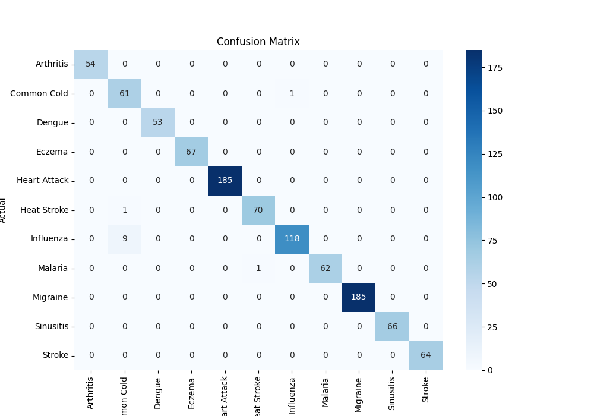
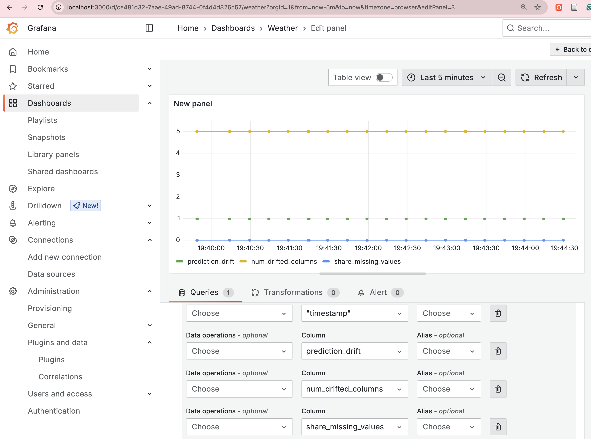
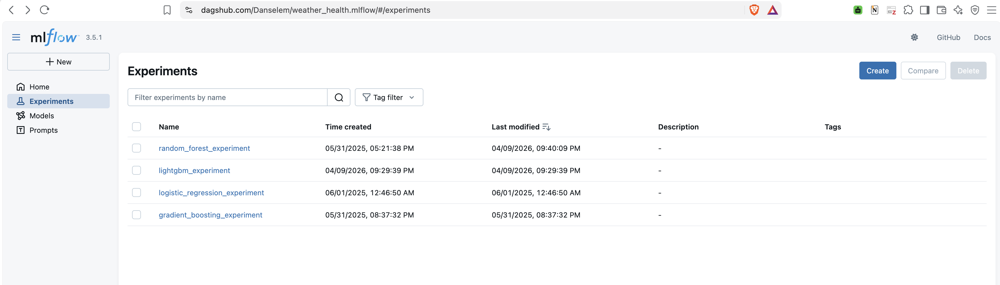
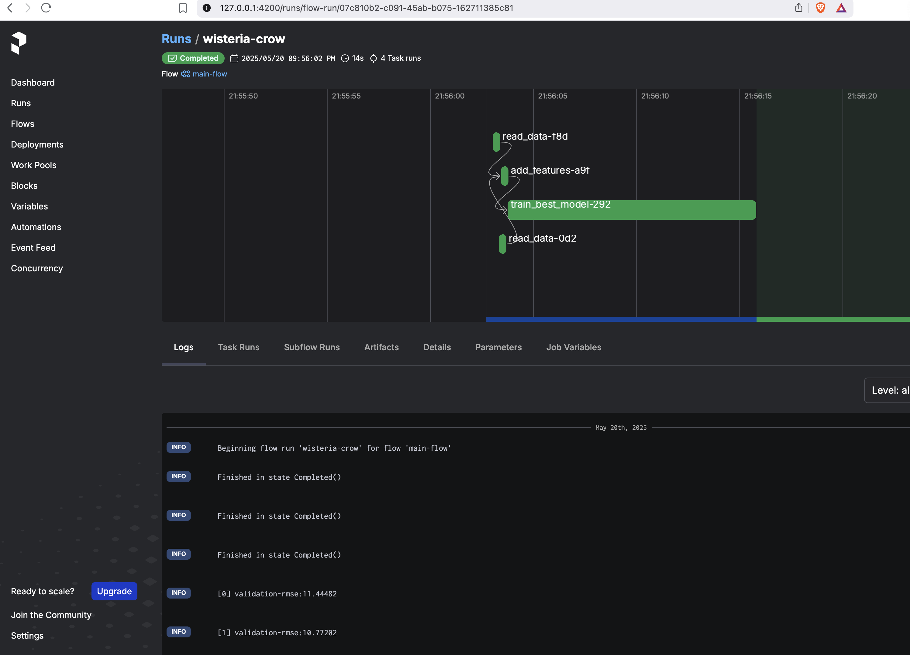

# From a Broken Pipeline to a Monitored MLOps System

### What I learned rebuilding a weather-disease predictor end to end

Most ML portfolio projects stop when a notebook produces a good score. This one
started there — and then spent most of its life on the harder question: *can I
trust the score, reproduce it, ship it, and notice when it stops working?*

This is the story of rebuilding the project from a collection of scripts into a
reproducible, monitored MLOps system: what the numbers actually say, what broke,
how I fixed it, and what I would do next.

**Live demo:** [Swagger UI](https://weather-health-587752925399.us-central1.run.app/docs) · [Health](https://weather-health-587752925399.us-central1.run.app/health)

---

## TL;DR

| Question | Answer |
|---|---|
| Task | 11-class disease classification from weather and symptom features |
| Held-out accuracy | **0.9789** |
| Held-out macro F1 | **0.9793** |
| 5-fold CV accuracy | **0.9794 ± 0.0035** (95% CI 0.9764–0.9825) |
| 5-fold CV macro F1 | **0.9790 ± 0.0041** (95% CI 0.9754–0.9826) |
| Calibration | Brier **0.0405**, ECE **0.0182** |
| Weather-only baseline | 0.3761 accuracy / 0.2294 macro F1 |
| Symptoms-only baseline | 0.9870 accuracy / 0.9880 macro F1 |
| Honest conclusion | The model learns symptoms, not weather |
| Live demo | [Cloud Run Swagger](https://weather-health-587752925399.us-central1.run.app/docs) |

The wiring mattered more than the model:

- DVC owns data, models, reference data, metrics, and plots.
- MLflow owns experiments and the `lightgbm_best_model@champion` alias.
- FastAPI serves a complete scikit-learn pipeline, not a bare classifier.
- Predictions and feedback are logged for monitoring.
- Evidently compares live traffic to a pinned reference.
- Grafana shows drift and API/model performance.
- GitHub Actions gates lint, types, coverage, DVC reproduction, model quality,
  Docker smoke tests, Terraform validation, and security checks.
- Prefect runs a daily monitoring flow and can trigger a guarded retrain.

---

## The honest data story

The dataset is the public **“Weather-related disease prediction”** dataset. It
starts with 5,200 rows and 51 columns. After removing 219 duplicate rows, 4,981
rows remain: 45 features and 11 disease classes.

The important discovery was not the accuracy. It was this:

> Every cleaned feature combination maps to exactly one disease label.

The dataset is effectively deterministic by construction. A model can learn the
mapping almost perfectly because the mapping *is* the data-generating process.
That makes the headline score a property of the synthetic dataset, not evidence
of clinical skill.

The second discovery was feature importance. Weather is not doing the work:

| Feature set | Features | Accuracy | Macro F1 |
|---|---:|---:|---:|
| Weather only | 3 | 0.3761 | 0.2294 |
| Symptoms only | 42 | 0.9870 | 0.9880 |
| Full | 45 | 0.9799 | 0.9788 |


The full model is slightly *worse* than symptoms-only. Weather adds noise, not
signal, in this dataset. That is the honest framing: a symptom-based classifier
with weather covariates, demonstrated as an MLOps system.

---

## Architecture

```mermaid
flowchart LR
    Raw[Raw data] --> DVC[DVC remote]
    DVC --> Clean[Clean]
    Clean --> Validate[Data contract]
    Validate --> Transform[Split / encode]
    Transform --> Train[Train + Hyperopt]
    Train --> MLflow[(MLflow registry)]
    MLflow -->|@champion| Image[Docker image]
    Image --> API[FastAPI]
    API --> Store[(Prediction store)]
    Store --> Evidently[Evidently drift]
    Evidently --> Grafana[Grafana]
    Evidently -->|alert| Webhook[Slack / webhook]
    Evidently -->|repeated failure| Retrain[Guarded retrain]
    Retrain --> MLflow
```

Four contracts keep training and serving aligned:

1. **Feature order** is written to `data/processed/feature_order.json`.
2. **Label mapping** is a `LabelEncoder` fitted on training labels only.
3. **Preprocessing** is inside the model: `Pipeline(MinMaxScaler -> LGBMClassifier)`.
4. **Reference data** is the held-out evaluation set with model predictions,
   pinned by DVC and used by monitoring.

---

## The numbers

### Held-out test set

The test set is 20% of the cleaned data, stratified. It is not used for
hyperparameter tuning or model selection. Those use a separate validation split
from the training data.

| Metric | Value |
|---|---:|
| Accuracy | 0.9789 |
| Macro precision | 0.9797 |
| Macro recall | 0.9793 |
| Macro F1 | 0.9793 |

### Cross-validation

Five-fold stratified CV on the training data:

| Metric | Mean | Std | 95% CI |
|---|---:|---:|---:|
| Accuracy | 0.9794 | 0.0035 | 0.9764–0.9825 |
| Macro F1 | 0.9790 | 0.0041 | 0.9754–0.9826 |

### Calibration

| Metric | Value |
|---|---:|
| Brier score (multiclass) | 0.0405 |
| Expected calibration error | 0.0182 |


The model is reasonably calibrated on the synthetic test set. That does not
guarantee calibration under a real population shift.

### Slices

| Slice | n | Accuracy | Macro F1 |
|---|---:|---:|---:|
| Age <30 | 233 | 0.9700 | 0.9711 |
| Age 30–44 | 162 | 0.9877 | 0.9904 |
| Age 45–59 | 192 | 0.9948 | 0.9952 |
| Age 60+ | 410 | 0.9732 | 0.9700 |
| Gender 0 | 497 | 0.9799 | 0.9819 |
| Gender 1 | 500 | 0.9780 | 0.9754 |


Accuracy gap: **0.0248** across age bands, **0.0019** across gender. These are
descriptive slices, not a formal fairness certification.

### Explainability

SHAP is now part of the pipeline. The top mean absolute attributions are
`headache`, `chest_pain`, `nausea`, `vomiting`, `high_fever`, `Temperature (C)`,
`dizziness`, `severe_headache`, `rashes`, and `Age`.


Confusion matrix:



---

## What broke, and how I fixed it

This is the part that mattered most.

### 1. Evaluation crashed immediately

`python -m src.evaluate` failed with:

```text
'WeatherDiseaseEvaluator' object has no attribute 'model_path'
```

The class also referenced undefined output paths and expected a pipeline with
`named_steps["clf"]`, but the saved artifact was a PyFunc wrapper.

**Fix:** define the artifact contract, load the actual model type, write every
output declared in `dvc.yaml`, and stop swallowing exceptions.

### 2. “Best model” selection was wrong

The registry query used:

```python
order_by=["metrics.F1 ASC"]
```

I reproduced it in a local MLflow store: uppercase `F1` was silently ignored, so
the first run was selected. Lowercase `f1 ASC` selected the *worst* run.

**Fix:** select `metrics.loss ASC`, filter out the parent run, and promote the
winner to the `@champion` alias.

### 3. The serving artifact was stale

`models/weather_disease_model.pkl` and `service/weather_disease_model.pkl` had
different hashes. They scored 0.9820 and 0.9692 macro F1 on the same test set.
The Lambda copies matched the stale service model.

**Fix:** one fetch path from MLflow, `model_metadata.json`, a `MODEL_VERSION`
build arg, and a single canonical Dockerfile.

### 4. DVC was decorative

DVC outputs were committed to Git, `.dvc` metadata was ignored, `dvc.lock` was
missing, and the train stage declared a model file it never wrote.

**Fix:** untrack outputs from Git, commit DVC pointers and `dvc.lock`, make every
stage write exactly its declared outputs, push the cache, and add `dvc repro`
to CI.

### 5. Hydra overrides silently failed

`model=lightgbm` failed because the defaults list had no `model` group. Pipeline
sub-stages composed the config again without overrides, so `make pipeline-prod`
ran the dev config.

**Fix:** add the model group, flatten env/model precedence in `src/config.py`,
and propagate overrides through every stage.

### 6. The label encoder was fitted twice

`encode_labels(y_train)` and `encode_labels(y_test)` both called
`fit_transform`, and the test-fitted encoder was the one saved.

**Fix:** fit once on train, transform test, and save the train-fitted encoder.

### 7. Scaling lived outside the model

Training, the API, Lambda, and the old Evidently script each scaled features
separately. The old monitoring script even double-scaled already-scaled data.

**Fix:** wrap preprocessing and model in one sklearn pipeline. Serving accepts
raw features and the pipeline does the rest.

### 8. The test set was used for model selection

Every model family was compared on the test set, so the reported score was
optimistic and not a held-out estimate.

**Fix:** split training data into fit/validation; select on validation; touch the
test set once in evaluation.

### 9. Grafana panels were broken

The dashboard referenced datasource UID `PCC52D03280B7034C`, but the provisioned
datasource had no UID, so Grafana generated a different one.

**Fix:** declare `uid: psql-monitoring`, update queries to
`monitoring_metrics` and `performance_metrics`, and add API/performance panels.

### 10. CI was theatre

The original workflow skipped tests, ignored mypy failures, and ignored
Hadolint failures. The deploy workflows lived in nested `.github` folders that
GitHub Actions never reads.

**Fix:** real gates for Ruff, mypy, coverage, DVC reproduction, model quality,
Docker smoke tests, Terraform validation, and Checkov. Add a root-level
deploy workflow.

### 11. CI failed after all the code passed locally

The clean clone failed with:

```text
hydra.errors.MissingConfigException: In 'config': Could not find 'env/dev'
```

`config/env/*.yaml` had never been committed. `.gitignore` contained `ENV/`, and
on a case-insensitive filesystem that matched `config/env`.

**Fix:** root-anchor the ignore rules (`/ENV/`) and commit the Hydra environment
configs. CI then passed.

---

## Monitoring, alerting, and retraining

The monitoring loop is now a real loop:

1. Every prediction is logged with request ID, features, label, confidence,
   top-k, model version, and latency.
2. The API exposes `/feedback` for delayed ground truth and `/stats` for counts.
3. `src/evidently_metrics.py` compares the current window to the pinned
   reference and runs drift tests.
4. Metrics go to `monitoring_metrics`; performance from feedback goes to
   `performance_metrics`.
5. Grafana shows drift, missing values, request rate, p95 latency, error rate,
   confidence, prediction distribution, and model performance.
6. A failed report writes an alert JSON and optionally posts to
   `ALERT_WEBHOOK_URL`.
7. After repeated failures, it dispatches a retrain workflow — but never
   auto-deploys.



The retrain workflow trains, evaluates, runs the quality gate, and registers a
new champion. A human still decides when to deploy.




---

## CI/CD and infrastructure

CI runs on every push and pull request:

1. Ruff and mypy on core modules.
2. `dvc pull` + pytest + coverage gate.
3. `dvc repro` + data contract + model quality gate.
4. Docker build and `/ready` + `/predict` smoke test.
5. Terraform format/validate + Checkov high-severity scan.

Deployment is manual and environment-gated. It fetches
`lightgbm_best_model@champion`, builds an image tagged with the model version,
registers a new ECS task definition, updates the service, and smoke-tests the
ALB.

For the public demo I deployed the same image to Cloud Run in
`us-central1`. The image is built for `linux/amd64`, Cloud Run is capped at five
instances, and prediction logs persist in a Cloud SQL Postgres instance through
the Cloud Run connector. The live endpoint and Swagger UI are linked at the top
of this post.

The AWS stack uses private ECS subnets behind a NAT gateway, an ALB in public
subnets, Secrets Manager for the database password, remote S3/DynamoDB state,
and an optional monthly budget. It is validated with `terraform validate` and
Checkov, but **not applied** in this repository — that requires your AWS account.

Rollback:

```bash
./scripts/rollback.sh <cluster> <service> <task-family> <revision>
```

---

## Limitations

- Synthetic, deterministic labels; metrics are optimistic for real data.
- No external or temporal validation.
- Weather has little standalone signal; the model is symptom-driven.
- Slice analysis is descriptive, not a formal fairness audit.
- Alerting and retraining need optional webhook/GitHub secrets.
- The AWS stack is validated but not deployed.
- The ALB terminates HTTP only; add ACM/HTTPS and WAF before production.

---

## What I would do next

1. **External validation.** Test on a real clinical or public-health dataset and
   report calibration under shift.
2. **Temporal evaluation.** Add a time-based split if timestamped data becomes
   available.
3. **Fairness audit.** Move beyond descriptive slices to formal subgroup
   reporting and mitigation.
4. **HTTPS + WAF.** Add an ACM certificate, HTTPS listener, and WAF to the ALB.
5. **Real alert delivery.** Wire Slack/PagerDuty and test the retrain dispatch
   end to end.
6. **Cost and load testing.** Benchmark ECS autoscaling and set budget alarms.
7. **Model monitoring on labels.** Expand performance monitoring from feedback
   to delayed-label cohorts.

---

## Reproduce it

```bash
git clone https://github.com/Danselem/weather_health.git
cd weather_health

uv sync --frozen
cp .env.example .env      # DVC/MLflow credentials if needed
dvc pull

make dvc                  # clean → validate → transform → train → evaluate → analysis
make test
make serve_local          # http://localhost:8080
make start-monitoring     # API :8000, Grafana :3000, Adminer :8081
make drift-demo
```

Key artifacts:

- `reports/evaluation_metrics.csv`
- `reports/ablation_metrics.png`
- `reports/calibration_metrics.csv`
- `reports/cv_metrics.csv`
- `reports/slice_metrics.png`
- `reports/shap_summary.png`
- `MODEL_CARD.md`
- `DATA_CARD.md`
- `docs/RUNBOOK.md`

---

## Links

- Repository: https://github.com/Danselem/weather_health
- Live API: https://weather-health-587752925399.us-central1.run.app/docs
- Experiments: https://dagshub.com/Danselem/weather_health/experiments
- CI: https://github.com/Danselem/weather_health/actions

Thanks to the open-source communities behind Python, scikit-learn, LightGBM,
MLflow, DVC, Prefect, Evidently, FastAPI, Docker, Terraform, and Grafana.
