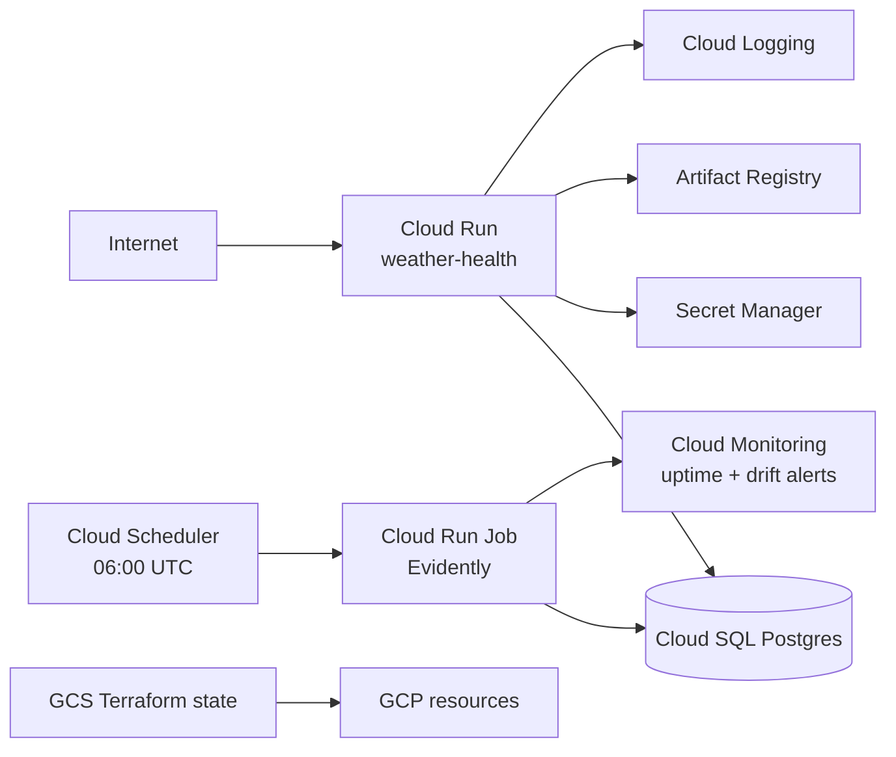

# Architecture

## System flow

```mermaid
flowchart TB
    subgraph Data
        Raw[Raw CSV] --> DVC[DVC remote]
        DVC --> Clean[Clean + UUID]
        Clean --> Validate[Data contract]
        Validate --> Transform[Split / encode / feature order]
    end

    subgraph Training
        Transform --> HPO[Hyperopt + MLflow tracking]
        HPO --> Registry[MLflow registry]
        Registry -->|@champion| Artifact[Model pipeline artifact]
    end

    subgraph Serving
        Artifact --> Image[Docker image]
        Image --> API[FastAPI]
        API --> Store[(Predictions + feedback)]
    end

    subgraph Monitoring
        Store --> Drift[Evidently drift vs reference]
        Scheduler[Cloud Scheduler] --> Job[Cloud Run monitoring job]
        Job --> Drift
        Drift --> Dashboard[/monitoring dashboard/]
        Drift --> Alert[Cloud Monitoring email / webhook]
        Drift --> Trigger[Guarded retrain]
    end

    Trigger --> HPO
```

## Components

| Component | Responsibility |
|---|---|
| Hydra | Environment/model configuration; flattened into runtime config |
| DVC | Data, model, reference, metrics, and plot versioning |
| MLflow | Experiment tracking, signatures, model registry, `@champion` |
| Prefect | Optional local flow orchestration; training flows also run via DVC/CI |
| FastAPI | Prediction, feedback, health, readiness, version, stats |
| PostgreSQL/SQLite | Prediction log, feedback labels, monitoring/performance metrics |
| Evidently | Drift tests against a pinned reference window |
| `/monitoring` + Grafana | Live in-app metrics; Grafana remains the local compose dashboard |
| GitHub Actions | Quality, data/model gates, Docker smoke, deploy, retrain |
| Terraform | **Live:** GCP Cloud Run, Cloud SQL, Secret Manager, Cloud Scheduler; **reference:** AWS ECS |

## GCP live topology



## AWS reference stack

AWS ECS/Fargate, ALB, private subnets, Secrets Manager, ECR, S3, and
S3/DynamoDB state are defined in `infra-aws/`. They are validated by Terraform
and Checkov but **not deployed**. Treat them as an optional IaC reference, not
the live system.

## Data and model contract

- Raw data: DVC-tracked.
- Feature order: `data/processed/feature_order.json`.
- Label mapping: `data/processed/label_encoder.pkl`, fitted on train only.
- Model: scikit-learn `Pipeline(MinMaxScaler -> LGBMClassifier)`.
- Serving applies the pipeline directly; scaling is never duplicated.
- Reference: `data/processed/reference.parquet` written by evaluation.

## Environments

| Environment | Purpose |
|---|---|
| dev | Fast local iteration; 2 hyperopt trials |
| staging | Pre-production checks; 3 trials |
| prod | Final training; 10 trials, `@champion` promotion |

## Design decisions

- [ADR 0001: Single cloud target](adr/0001-single-cloud-target.md)
- [ADR 0002: DVC and MLflow artifact split](adr/0002-dvc-and-mlflow.md)
- [ADR 0003: Pipeline and champion alias](adr/0003-pipeline-and-champion.md)
- [ADR 0004: Monitoring and guarded retraining](adr/0004-monitoring-and-retraining.md)
